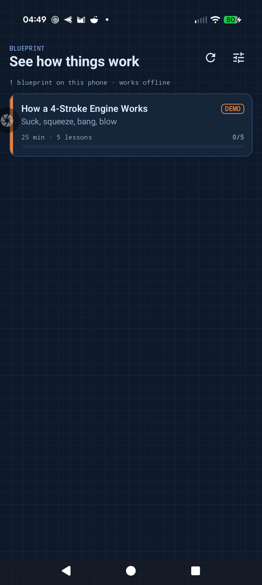
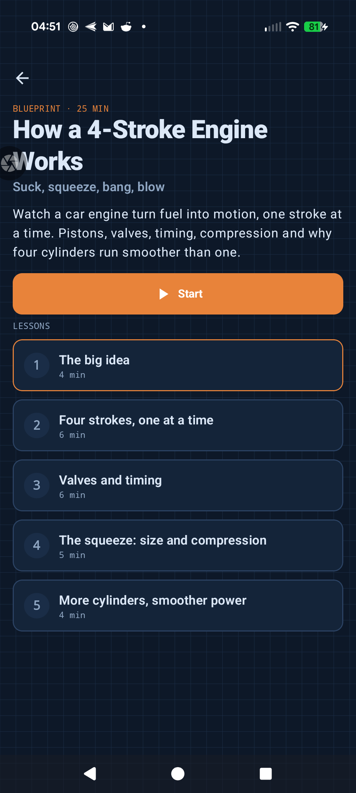
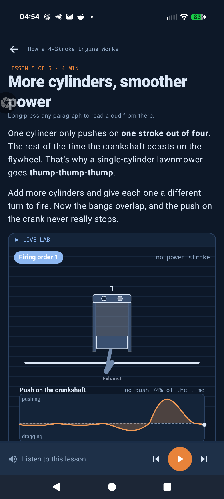
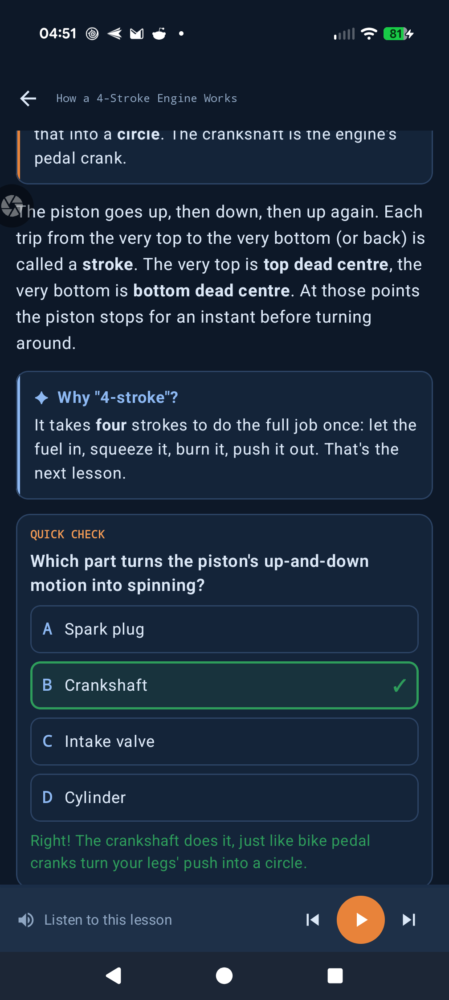
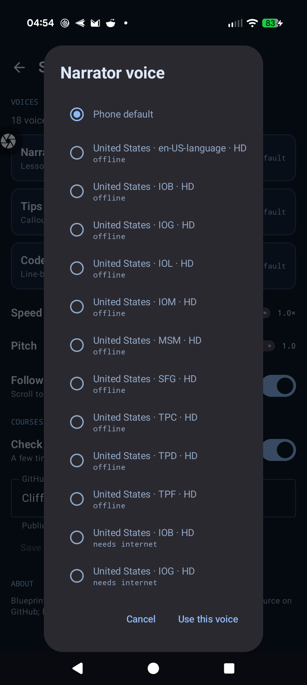
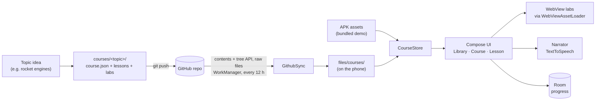

# Blueprint

**See how anything works, one moving diagram at a time.**

Blueprint is a native Android learning app. Every topic is a short course, called a *blueprint*, built around live, interactive animations: a cutaway engine you can slow down, gears you can re-ratio, a valve-timing wheel you can drag through the RPM range. Lessons can be read aloud in the voice you choose, with each word highlighted as it's spoken.

New topics show up on their own. Every course lives in this repo's [`courses/`](courses) folder, and the app downloads new and updated ones in the background.

| Library | Course | Lesson + live lab | Firing-order lab | Quick check | Voices |
|---|---|---|---|---|---|
|  |  |  |  |  |  |

*Screenshots from a Pixel 9 Pro XL (Android 17) in dark mode.*

## Courses

| Course | Length | Labs |
|---|---|---|
| [How a 4-Stroke Engine Works](courses/4-stroke-engine) (demo, bundled in the app) | ~25 min · 5 lessons | Engine cutaway, valve timing, compression ratio, firing order |

More on the way: wing lift, pin-tumbler locks, gears, WW2 bomber navigation, discrete math, function reading.

## Features

- **Live labs:** each concept has an animation you can play, pause, step through and tweak with sliders. Labs run offline inside the app.
- **Read aloud:** Android text-to-speech with a **separate voice for each role** (lesson text, tips/notes, code walk-throughs), adjustable speed and pitch, and word-by-word highlighting. Long-press any paragraph to start reading from there.
- **Follow along:** the lesson scrolls to whatever is being read.
- **Quick checks:** multiple-choice questions with instant feedback and explanations. Scores are saved per lesson.
- **Progress:** lessons tick off as you finish them; "Continue" picks up where you left off.
- **Self-updating library:** courses are folders in this public repo. The app checks GitHub a few times a day (WorkManager, network-only) and downloads only the course folders that changed. No account or token needed.
- **Bullet-first lessons:** topics are explained as short intro lines plus bullet lists, read aloud one bullet at a time.
- **Offline-first:** the demo course is bundled into the APK at build time; everything downloaded stays on the phone.
- **Light and dark** "blueprint paper" themes, edge-to-edge.

## How it works



### Architecture

| Layer | What it does |
|---|---|
| `data/Models.kt` | Course format: `CourseManifest`, `Lesson`, and a sealed `Block` type (text, callout, steps, math, lab, quiz, code). Unknown block types degrade to `Unsupported`, so old app versions can still open newer courses. |
| `data/CourseStore.kt` | Finds bundled and downloaded courses; a downloaded copy overrides a bundled one with the same id. |
| `data/Database.kt` | Room: lesson progress, last-opened lesson, and which course versions are installed, with a schema migration that keeps progress across updates. |
| `sync/GithubSync.kt` | List `courses/` → compare each folder's git tree SHA → download only changed folders → validate `course.json` → swap in. Refuses paths that escape the course folder. |
| `tts/Narrator.kt` | Speaks one utterance at a time so it can switch voices per role, skip, pause and resume; exposes word ranges for highlighting. |
| `ui/…` | Jetpack Compose + Material 3 screens with ViewModels and `StateFlow`. Labs are served from a fake `https://appassets.androidplatform.net` origin, so they behave like normal web pages without file access. |

### Design decisions

- **Native shell, web labs.** Screens, storage, sync and speech are native Kotlin. The animations are small HTML canvas labs, the best tool for 2-D motion graphics, and the same files work in any browser, so each course repo doubles as a website.
- **One repo, a folder per course.** Everything lives in one place, while each course still updates without an app release. Sync uses each folder's git tree SHA, so only courses that changed are downloaded.
- **Spoken text = displayed text.** The inline markdown parser strips markers identically for display and speech, so the TTS engine's character ranges line up with the screen. There's a unit test for it.
- **No icon library.** The ten icons the app needs are defined as vector paths, which keeps the APK lean.

## Tech stack

Kotlin · Jetpack Compose · Material 3 · Navigation Compose · Room (KSP) · DataStore · WorkManager · kotlinx.serialization · AndroidX WebKit · Android TextToSpeech · GitHub REST API · GitHub Actions

## Repo layout

```
blueprint/
├── app/                      # Android app (Kotlin, Compose)
├── courses/
│   └── <topic>/
│       ├── course.json       # id, title, minutes, accent colour, lesson list
│       ├── lessons/*.json    # blocks: list, text, heading, callout, steps, math, lab, quiz, code
│       └── labs/*.html       # self-contained animated labs (+ shared kit.js / kit.css)
└── docs/screenshots/
```

Add a folder under `courses/`, push, and every installed app picks it up.

## Build

Requires JDK 17 and the Android SDK (compileSdk 37).

```bash
./gradlew testDebugUnitTest   # unit tests
./gradlew assembleDebug       # app/build/outputs/apk/debug/app-debug.apk (bundles courses/4-stroke-engine)
```

Every push to `main` runs the tests and builds the APK in GitHub Actions. The APK is attached to the workflow run.

## Roadmap

- More blueprints: wing lift, pin-tumbler locks, gears, WW2 bomber navigation, discrete math, function reading
- Library grouped by category
- Choice of AI voices
- Code walk-through lessons with line-by-line narration
- Signed releases on the Releases page
- Full-screen lab mode

## Built with AI

Designed and directed by [CliffSolo](https://github.com/CliffSolo); code and course content written with [Claude Code](https://claude.com/claude-code).

## License

[MIT](LICENSE)
